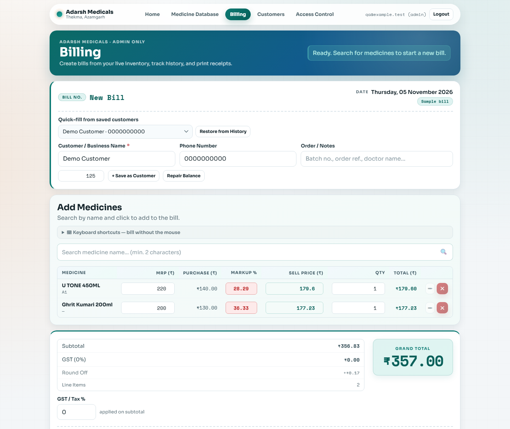

# Medicine Rack Tracker

Medicine Rack Tracker is a web app built for Adarsh Medicals. It started with a simple problem at the counter: finding a medicine on the right rack while a customer is waiting. It grew into a tool for inventory, billing, and customer balances.



*The screenshot uses sample data. The shop's app requires sign-in.*

## What it does

- **Inventory:** Search by medicine name or rack, check stock and expiry dates, and import inventory from Excel, CSV, or JSON.
- **Billing:** Add medicines from search, reuse the last selling price, adjust quantities and rates, and print receipts. Desktop shortcuts cover common billing actions.
- **Customer balances:** Record credit sales and partial payments. The amount due is calculated from the customer's opening balance, bills, and payments, so edits or deletions are reflected in the balance.
- **Staff access and reporting:** Admins can manage access. Only the business owner can open PIN-protected profit reports, with presets and an inclusive From/To date range in India time. Employees can look up medicines.

## How it works

The frontend uses HTML, CSS, and vanilla JavaScript. Vercel runs the Node.js handlers in [`api/`](api/). Supabase handles sign-in and stores inventory, bills, and payments in Postgres.

## Run the tests

From the repository root, run:

```sh
npm ci
npm test
```

The financial API tests run the staged migration in isolated embedded PostgreSQL (PGlite). The pinned test dependency is installed by npm ci; no live database credentials are needed. See [the test guide](tests/README.md) for coverage and individual commands.

To run the app with a backend, use your own Supabase project and copy [`.env.example`](.env.example) to `.env.local` for local Vercel development. The SQL files in this repo are incremental changes for an existing database; they don't create the full schema from scratch.

Billing now requires the staged atomic-ledger migration and matching API/frontend deployment. Read [billing integrity rollout and finding coverage](docs/billing-integrity-fixes.md) before upgrading an existing shop. Production data is not repaired or migrated automatically.
